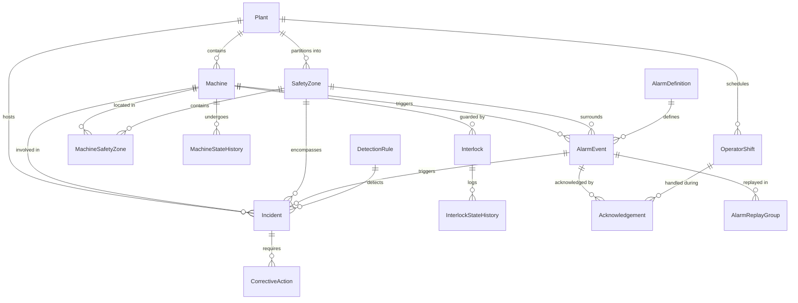

# Industrial Safety Intelligence Platform - Entity Relationships

This document outlines the architectural relationships, cardinality rules, referential integrity strategies, and ER diagrams for the Industrial Safety Intelligence Platform.

---

## 1. Entity Relationship Diagram (Mermaid)

---

## 2. Cardinality and Referential Rules

| Parent Entity | Child Entity | Cardinality | Foreign Key Constraint | Delete Behavior | Rationale |
|---|---|---|---|---|---|
| `plants` | `machines` | 1 to Many (1:N) | `machines.plant_id -> plants.plant_id` | RESTRICT | A plant cannot be deleted while machines are assigned. Machines must be retired instead. |
| `plants` | `safety_zones` | 1 to Many (1:N) | `safety_zones.plant_id -> plants.plant_id` | RESTRICT | Safety boundaries belong to the physical facility. |
| `plants` | `operator_shifts`| 1 to Many (1:N) | `operator_shifts.plant_id -> plants.plant_id` | RESTRICT | Shifts are plant-specific schedule intervals. |
| `machines` | `interlocks` | 1 to Many (1:N) | `interlocks.machine_id -> machines.machine_id` | CASCADE | Interlocks physically belong to machines. |
| `machines` | `machine_safety_zones` | 1 to Many (1:N) | `machine_safety_zones.machine_id -> machines.machine_id` | CASCADE | Historical zone assignments. |
| `safety_zones`| `machine_safety_zones` | 1 to Many (1:N) | `machine_safety_zones.safety_zone_id -> safety_zones.safety_zone_id` | RESTRICT | Zone mappings cannot leave orphaned machines. |
| `alarm_definitions` | `alarm_events` | 1 to Many (1:N) | `alarm_events.alarm_definition_id -> alarm_definitions.alarm_definition_id` | RESTRICT | Alarm events must correspond to active definition specifications. |
| `machines` | `alarm_events` | 1 to Many (1:N) | `alarm_events.machine_id -> machines.machine_id` | RESTRICT | Events are immutable industrial telemetry records. |
| `alarm_events` | `acknowledgements` | 1 to Many (1:N) | `acknowledgements.alarm_event_id -> alarm_events.alarm_event_id` | RESTRICT | Acknowledgements track human responses to specific alarms. |
| `incidents` | `corrective_actions` | 1 to Many (1:N) | `corrective_actions.incident_id -> incidents.incident_id` | RESTRICT | Corrective actions remediate root causes of documented incidents. |
| `alarm_events` | `incidents` | 1 to 0..1 (1:0..1) | `incidents.triggering_alarm_event_id -> alarm_events.alarm_event_id` | SET NULL | Incidents may stem from an alarm or un-alarmed mechanical conditions. |

---

## 3. Indexing Strategy for High Performance

To efficiently handle 50,000+ alarm events, high-volume sliding-window queries, and real-time dashboard analytics:

1. **`alarm_events` Indexes**:
   - `idx_alarm_events_event_timestamp` (`event_timestamp` DESC) - for time-range slicing.
   - `idx_alarm_events_machine_timestamp` (`machine_id`, `event_timestamp` DESC) - for machine-specific telemetry timelines.
   - `idx_alarm_events_definition_severity` (`alarm_definition_id`, `alarm_status`) - for SLA and severity analytics.
   - `idx_alarm_events_source` (`source_event_id`) - for duplicate flood and replay detection.

2. **`acknowledgements` Indexes**:
   - `idx_ack_alarm_event_id` (`alarm_event_id`) - for fast O(1) SLA response lookups.
   - `idx_ack_timestamp` (`acknowledgement_timestamp`) - for shift metrics.

3. **`incidents` Indexes**:
   - `idx_incidents_timestamp` (`incident_timestamp` DESC) - for recent incident feeds.
   - `idx_incidents_machine_plant` (`machine_id`, `plant_id`) - for repeated machine/zone incident clusters.
   - `idx_incidents_trigger_alarm` (`triggering_alarm_event_id`) - for traceability lookups.

4. **`corrective_actions` Indexes**:
   - `idx_corrective_actions_incident` (`incident_id`) - for incident remediation tracking.
   - `idx_corrective_actions_status` (`action_status`, `verification_status`) - for unverified action alerts.

5. **`machine_state_history` & `interlock_state_history`**:
   - `idx_msh_machine_time` (`machine_id`, `transition_timestamp` DESC).
   - `idx_ish_interlock_time` (`interlock_id`, `transition_timestamp` DESC).
